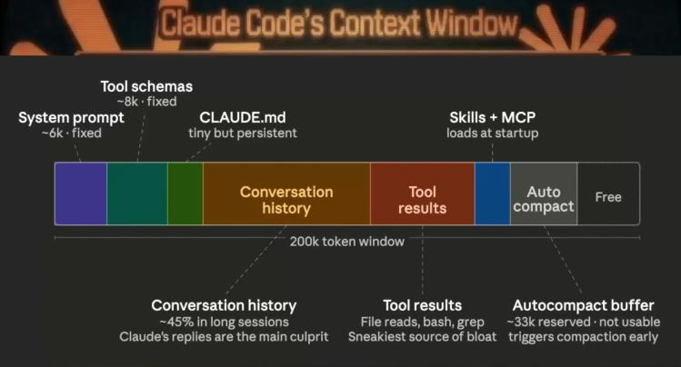
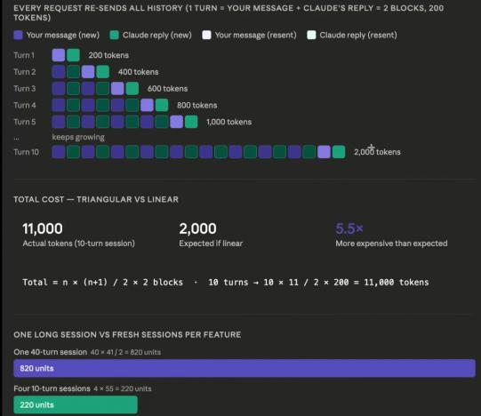
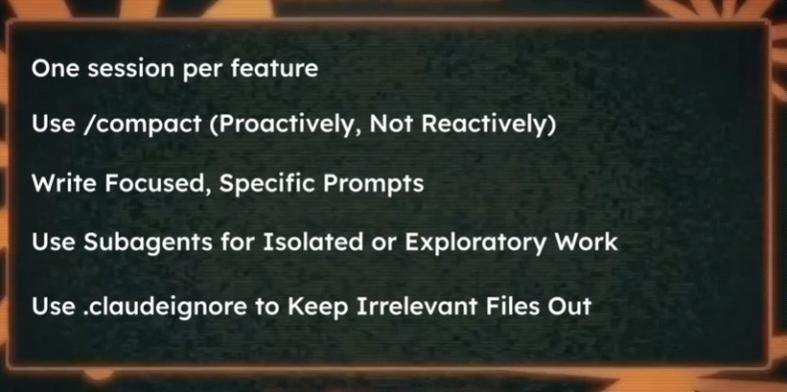

# 04 · Context Engineering

## Core ideas
- **Context window** = tokens the model can "see" at once.
- Sonnet 4.6, Opus 4.6 and Opus 4.7 → **1M tokens**.
- **New session → new context window.**
- **Every request re-sends the whole earlier conversation**, so cost grows with each turn (see the triangular-cost picture).
- ~**50k tokens** are already in use at the start (system prompt, tool schemas, skills, MCP...). Always present.
- `/context` shows context usage by category (percentages).

## Where the window goes

- **System prompt** ~6k (fixed), **tool schemas** ~8k (fixed), **CLAUDE.md** (tiny but persistent), **skills + MCP** (load at startup)
- **Conversation history**: about 45% in long sessions. Claude's replies are the main culprit.
- **Tool results** (file reads, bash, grep) are the sneakiest source of bloat.
- **Autocompact buffer**: ~33k reserved, not usable. It triggers compaction early.

## Why long sessions get expensive (triangular cost)

- Each turn re-sends all history, so total cost is *triangular*, not linear.
- Formula: `Total = n × (n+1) / 2 × 2 blocks` → 10 turns = 10 × 11 / 2 × 200 = **11,000 tokens** (5.5× more than linear 2,000).
- **One 40-turn session = 820 units** vs **four 10-turn sessions = 220 units**. Fresh session per feature is far cheaper.

## Auto-compact
- When usage reaches roughly 75–92% (a fixed percentage), Claude Code **auto-summarizes (compacts)** the conversation.
- The summary lives in the ~33k autocompact zone.
- Once that zone is used up, end the session and start a new one.

| Command | Effect |
|---|---|
| `/compact` | Summarize the conversation history and free up the session |
| `/clear` | Clear the session |
| `/context` | Show context usage by category |

## Subagents help with context
- Each subagent has its **own fresh context window**.
- Subagents return a **summary** to the main agent instead of all their messages. See [10 · Subagents](10-subagents.md).

## Good practices

1. One session per feature
2. Use `/compact` **proactively, not reactively**
3. Write focused, specific prompts
4. Use subagents for isolated or exploratory work
5. Use `.claudeignore` to keep irrelevant files out

---
Prev: [03](03-editing-code.md) · Next: [05 · CLAUDE.md & memory](05-claude-md-and-memory.md)
