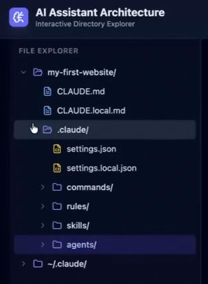
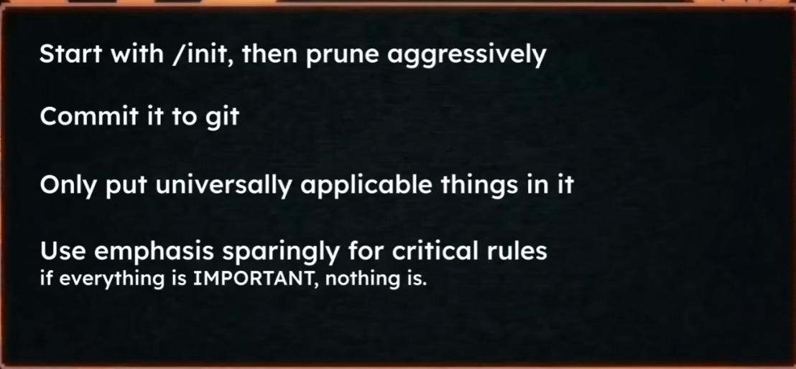
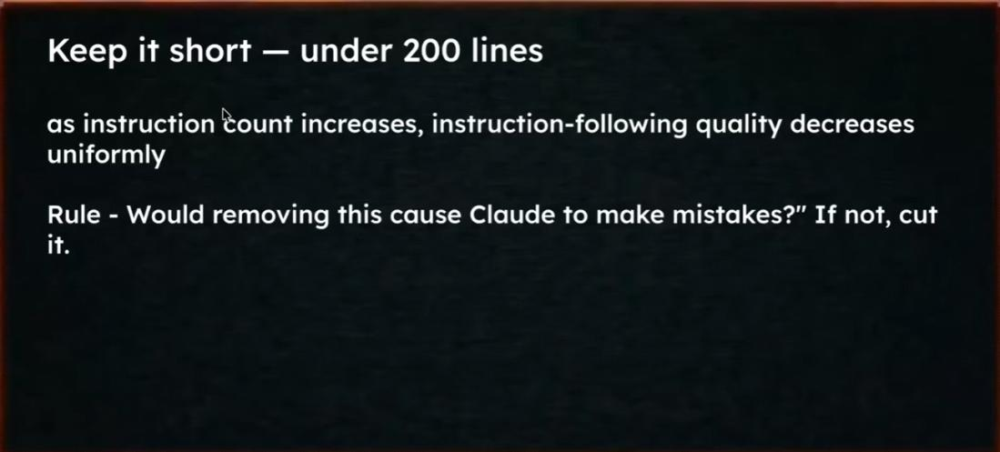
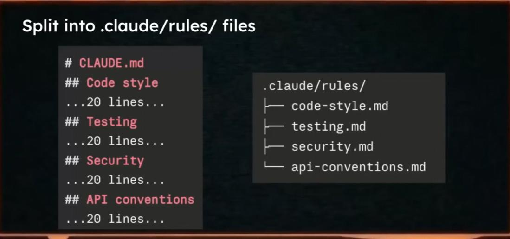
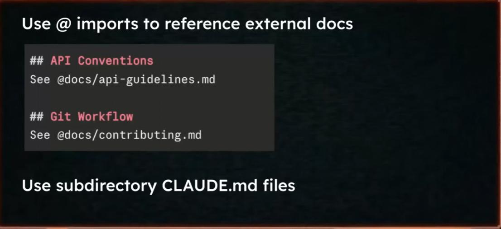

# 05 · CLAUDE.md, `.claude` Folder & Auto Memory

## What is CLAUDE.md?
A file that tells Claude **how to work on your codebase**. Without it you'd re-explain the project every session. One CLAUDE.md persists across **all sessions** in a project, and holds things you'd otherwise repeat in every prompt.

- Create manually, or run **`/init`** to have Claude generate it.

### What belongs in it
- What the project is about
- Project architecture
- Coding guidelines (e.g. use a logger)
- Preferred libraries and tools
- Commands for running, testing, debugging
- Critical rules, edge cases
- A roadmap: how Claude should proceed with subtasks

## Where it can live
| File | Purpose | Shared? |
|---|---|---|
| `project_root/CLAUDE.md` or `project_root/.claude/CLAUDE.md` | General guidelines for the whole team | Yes (git pushed) |
| `CLAUDE.local.md` | Your personal preferences and tricks | No (git-ignored) |
| `~/.claude/CLAUDE.md` | Guidelines across **all** your projects | No |
| `project_root/folder/CLAUDE.md` (or `.local.md`) | Folder-wise rules for large repos | Depends |

## The `.claude` folder


- Holds config: tool permissions, **skills, custom commands, subagents**.
- **Project level** (`.claude/` in the repo, shared with team) and **global level** (`~/.claude/`, PC-specific, not shared).
- Typical contents: `settings.json`, `settings.local.json`, `commands/`, `rules/`, `skills/`, `agents/`.

## Rules for writing CLAUDE.md


- Start with `/init`, then **prune aggressively**
- Commit it to git
- Only put **universally applicable** things in it
- Use emphasis sparingly for critical rules ("if everything is IMPORTANT, nothing is")



- **Keep it under 200 lines.** As instruction count grows, instruction-following quality drops uniformly.
- Test: *"Would removing this cause Claude to make mistakes?"* If not, cut it.

## What if it's longer than 200 lines?
**Solution 1: split into `.claude/rules/` files**



- Rules are **loaded only when relevant**, not every session.

**Solution 2: `@` imports and subdirectory CLAUDE.md files**



```md
## API Conventions
See @docs/api-guidelines.md

## Git Workflow
See @docs/contributing.md
```

**Also:** when Claude keeps making a mistake and you correct it, tell it to **add the lesson to CLAUDE.md**. Update it periodically so it matches current intent.

## Auto Memory (MEMORY.md)
- Claude automatically learns patterns from working on the project and stores them in **MEMORY.md**.
- Path: `~/.claude/projects/<project_name>/Memory/MEMORY.md`
- Loaded every session, just like CLAUDE.md. Both are "memory" for Claude.
- Only the **first 200 lines** are loaded each session.
- `/memory` shows the memory file(s).
- You can instruct it: "update your memory file and add the following information...".

---
Prev: [04](04-context-engineering.md) · Next: [06 · Spec-driven development](06-spec-driven-development.md)
