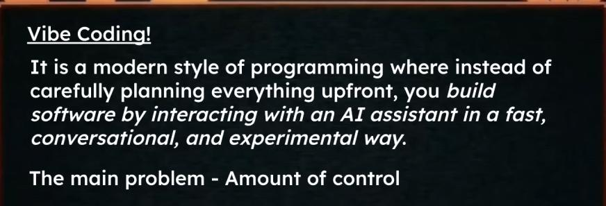
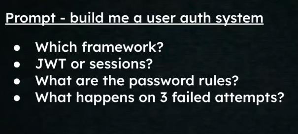
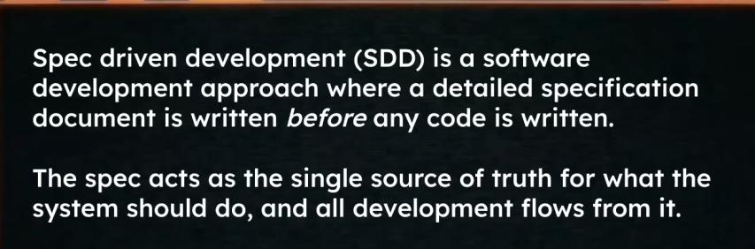
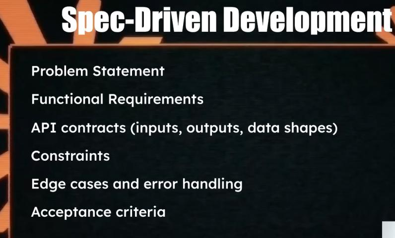
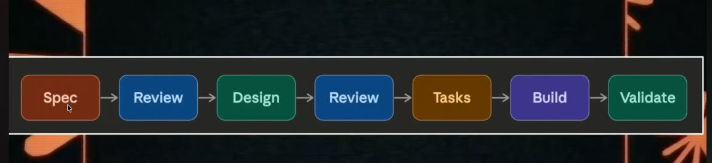
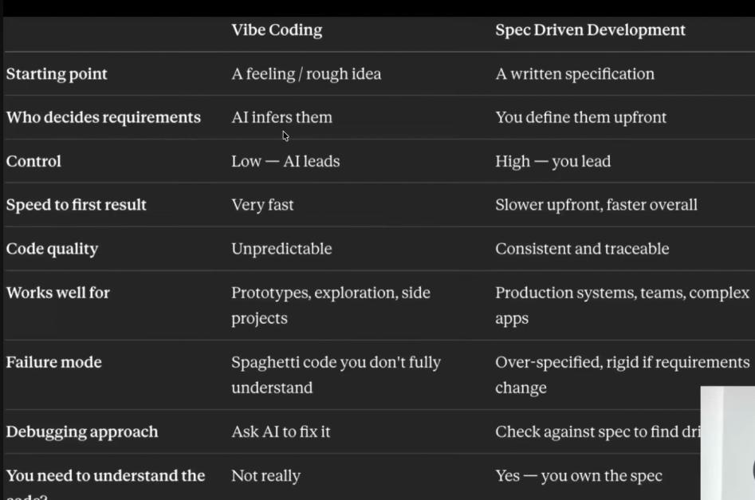

# 06 · Vibe Coding vs Spec-Driven Development (SDD)

## Vibe coding

Building software by chatting with an AI in a fast, experimental way, without planning upfront. **Main problem: loss of control.**

Example: the prompt *"build me a user auth system"* leaves unanswered questions:

- Which framework? JWT or sessions? What are the password rules? What happens on 3 failed attempts?
- The AI doesn't know your answers, so it guesses.

## Spec-driven development

A detailed **specification is written before any code**. It is the single source of truth, and all development flows from it. **You are the architect; AI builds to the spec.**

### What goes in a spec

- Problem statement
- Functional requirements
- API contracts (inputs, outputs, data shapes)
- Constraints
- Edge cases and error handling
- Acceptance criteria (**always end with success criteria and check them yourself**)

Write a spec **per feature**.

## The SDD flow

**Spec → Review → Design → Review → Tasks → Build → Validate**

- **Spec**: *what* feature we want.
- **Design spec**: the technical sheet, *how* to build it for the current tech stack. Tech stacks change, but the spec stays the "golden truth", so you can regenerate the design for a new stack.
- **Tasks**: break the design into small steps; each step can be handled by an agent, then validated.
- Future skill: **how well you can design systems**.

## Vibe coding vs SDD

| | Vibe Coding | Spec-Driven Development |
|---|---|---|
| Starting point | A feeling / rough idea | A written specification |
| Who decides requirements | AI infers them | You define them upfront |
| Control | Low (AI leads) | High (you lead) |
| Speed to first result | Very fast | Slower upfront, faster overall |
| Code quality | Unpredictable | Consistent and traceable |
| Works well for | Prototypes, exploration, side projects | Production systems, teams, complex apps |
| Failure mode | Spaghetti code you don't fully understand | Over-specified, rigid if requirements change |
| Debugging | Ask AI to fix it | Check against spec to find drift |
| Need to understand the code? | Not really | Yes, you own the spec |

## Practical routine with Claude
1. Use Claude to **generate a spec** for the feature (e.g. via a custom slash command, see [08](08-custom-slash-commands.md)).
2. **Review** the spec yourself.
3. Use **plan mode** to turn the spec into a technical design ([07](07-plan-mode-and-git-workflow.md)).
4. Ask Claude to split into small tasks; implement them yourself or with subagents.
5. Use **git** alongside it (branch per feature).

**Mantra:** SPEC → TECH SPEC → IMPLEMENT (keep checklists and verify).

---
Prev: [05](05-claude-md-and-memory.md) · Next: [07 · Plan mode & git workflow](07-plan-mode-and-git-workflow.md)
