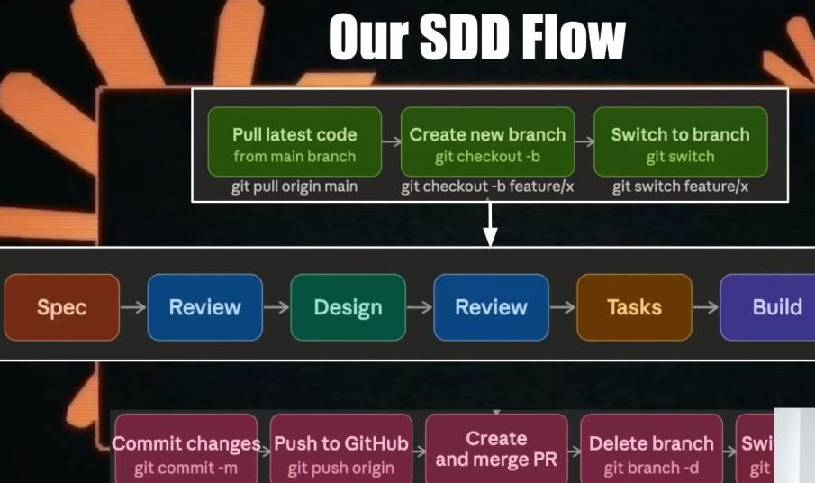

# 07 · Plan Mode & Git Workflow

Plan mode turns the **spec** into a **technical implementation plan** before any code is written. Enter it with `/plan`.

## Git flow for every feature


**Start (before the spec):**
```bash
git pull origin main                   # fetch latest
git checkout -b features/database-setup   # new branch (or: git switch feature/x)
```

**Then:** Spec → Review → Design → Review → Tasks → Build → Validate.

**Finish (after changes are done on the branch):**
```bash
git add .
git commit -m "message"
git push origin branch_name
# create & merge the pull request
# delete the branch on GitHub
git checkout main            # (git switch main)
git branch -D branch_name    # delete local branch
```

Rule: **new feature → new branch → test → PR → merge → delete branch.**

## Where files go
- Specs → `.claude/specs/` (written by human + AI together)
- Technical plans → `.claude/plans/`
- Steps: write spec → `/plan` to generate technical implementation → save plan → implement and check against it.

## Good practices for planning
1. **Plan mode with Opus** for complex thinking.
2. **Extended thinking** ("scratch pad"): Claude reasons before answering.
   - `/config` → *Thinking mode* true/false. Uses extra tokens while thinking.
3. **Effort level**: `/effort` → low / medium / high / max / auto. Recommended: **auto, high or max**.
4. **Ultraplan** (`/ultraplan`): for hard planning problems.
   - The plan is made **on Anthropic's web**, not locally. You view and edit it there, then bring it back to local.
   - **More costly** than plan mode. Use it when plan mode's result doesn't satisfy you.

> Tip: while in plan mode you can still switch models with `/model` (e.g. Opus to plan, Sonnet to execute).

---
Prev: [06](06-spec-driven-development.md) · Next: [08 · Custom slash commands](08-custom-slash-commands.md)
