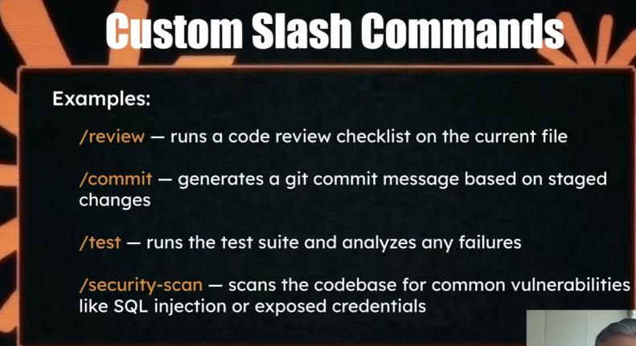

# 08 · Custom Slash Commands

Custom slash commands are **saved prompts for repeatable workflows**.

Examples:
- `/review`: runs a code-review checklist on the current file
- `/commit`: generates a commit message from staged changes
- `/test`: runs the test suite and analyzes failures
- `/security-scan`: scans for vulnerabilities (SQL injection, exposed credentials)

## Where they live
| Scope | Location |
|---|---|
| Project | `.claude/commands/` (inside the project) |
| User (global) | `~/.claude/commands/` |

Each command is a markdown file. Save, **restart Claude Code**, then type `/name` to see it like any built-in command. You give it a **description** and **allowed tools**.

## Example (Spendly project)
- **Normal command:** `.claude/commands/seed-user.md` → seeds random data into the DB ("seeding" = populating random data).
- **Command with arguments:** `.claude/commands/seed-expense.md` → populates expenses for a user.
  - Args: user id, number of expenses, how many previous months to cover.
- **Spec creator:** `create-spec.md` → creates a spec for any new feature (reference repo: `campusx-official/spendly`).

## Making `create-spec` smarter
- Before creating a spec, **check for uncommitted git changes**; if there are, handle them first.
- At the end, **create a new branch and switch to it**. Because this repeats for every feature, **automate it in the command**.
- Always end the spec with **success criteria**, then verify them.

## Feature workflow with commands
`/create-spec` → `/plan` → implement → (`/test-feature`, `/code-review-feature`, see [10](10-subagents.md)) → git ops.

> **Commands and skills are merging.** A skill's name shows up as a slash command too. See [09 · Skills](09-skills.md).

---
Prev: [07](07-plan-mode-and-git-workflow.md) · Next: [09 · Skills](09-skills.md)
