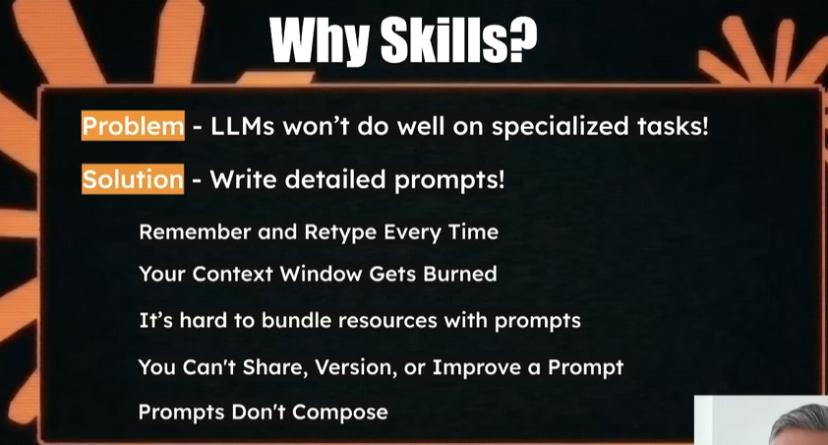
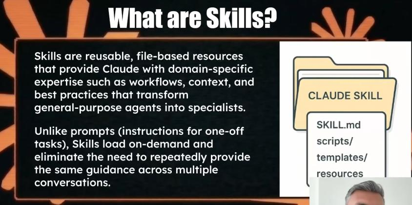
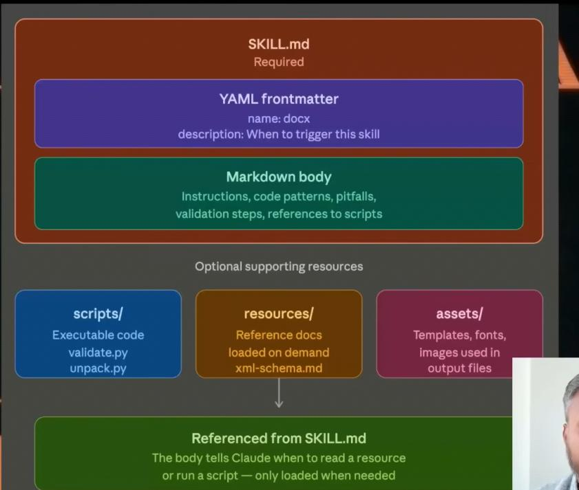
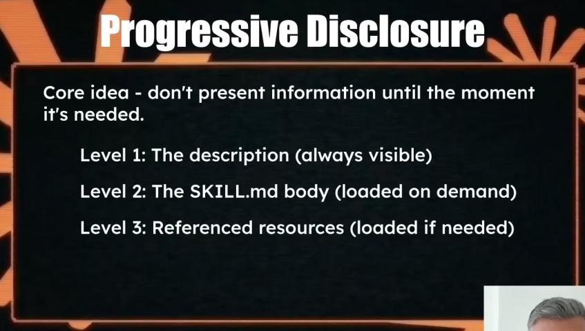
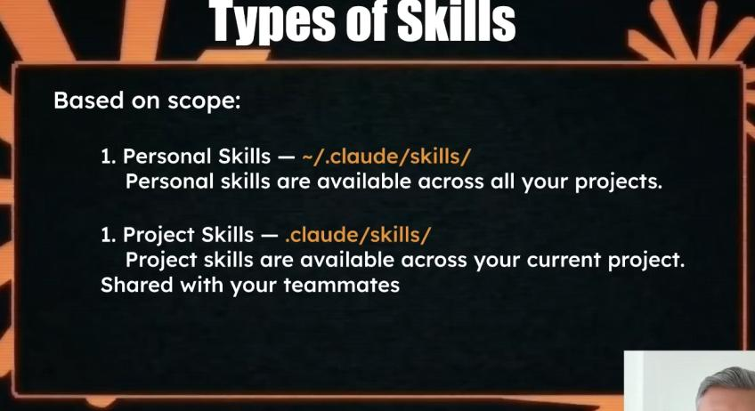
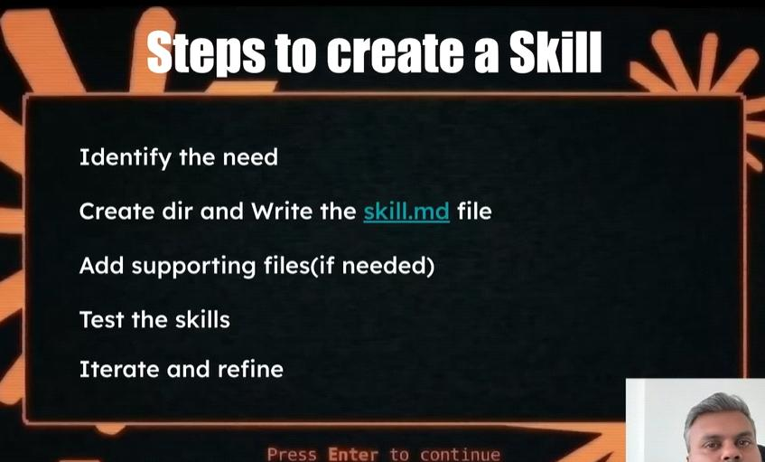

# 09 · Skills

## Why skills?


- **Problem:** LLMs don't do well on specialized tasks (e.g. making presentations: they lack layout/design/chart-placement know-how).
- **Naive fix:** write detailed prompts. But you must retype them, they burn context, you can't bundle resources, share/version/improve them, or compose them.
- With 10 specialized tasks, keeping 10 long prompts in the system prompt bloats the context window.
- **Skills** load **only when the task needs them**.

## What are skills?


Reusable, file-based resources giving Claude domain-specific expertise (workflows, context, best practices) that turn a general agent into a specialist. Unlike one-off prompts, they **load on demand**.

## Anatomy of a skill


```
.claude/skills/<skill-name>/
├── SKILL.md        (required)  YAML frontmatter + markdown body
├── scripts/        executable code (validate.py, unpack.py)
├── resources/      reference docs, loaded on demand
└── assets/         templates, fonts, images used in output
```

- **Frontmatter:** `name:` and `description:` (when to trigger the skill).
- **Body:** instructions, code patterns, pitfalls, validation steps, references to scripts.
- The body tells Claude *when* to read a resource or run a script.

> The PDF text writes `SKILLS.md`, but the slides use **`SKILL.md`**. Use `SKILL.md`.

## Progressive disclosure


Don't present information until the moment it's needed. It prevents context explosion.
1. **Level 1:** the *description* (always visible)
2. **Level 2:** the *SKILL.md body* (loaded on demand)
3. **Level 3:** *referenced resources* (loaded only if needed)

## Types of skills (by scope)


| Type | Location | Availability |
|---|---|---|
| Personal | `~/.claude/skills/` | All your projects |
| Project | `.claude/skills/` | Current project, shared with teammates |

Example layout: `.claude/skills/frontend-design/SKILL.md`, `.claude/skills/backend-design/SKILL.md`.

## Steps to create a skill


1. Identify the need
2. Create the directory and write `SKILL.md`
3. Add supporting files (if needed)
4. Test the skill
5. Iterate and refine

### Ways to get skills
1. Write manually (comes with experience)
2. Use the **skill-creator** skill in the Claude chatbot
3. Community / open-source skills (**watch out for security risks**)

## Handy facts
- Multiple skills can be **chained** to do a bigger task.
- A skill's `name` appears as a **slash command**, so you can trigger it manually *or* the model can trigger it automatically.
- To stop the model auto-using a skill, set `disable-model-invocation: true` in the frontmatter.
- Commands and skills are converging.
- `/rewind` goes back to an earlier point and undoes code changes.

---
Prev: [08](08-custom-slash-commands.md) · Next: [10 · Subagents](10-subagents.md)
