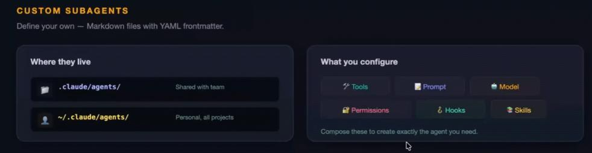
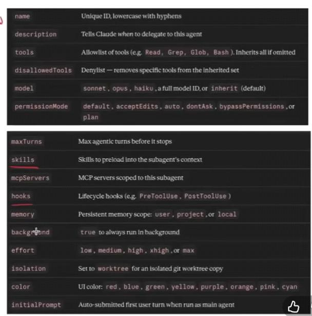
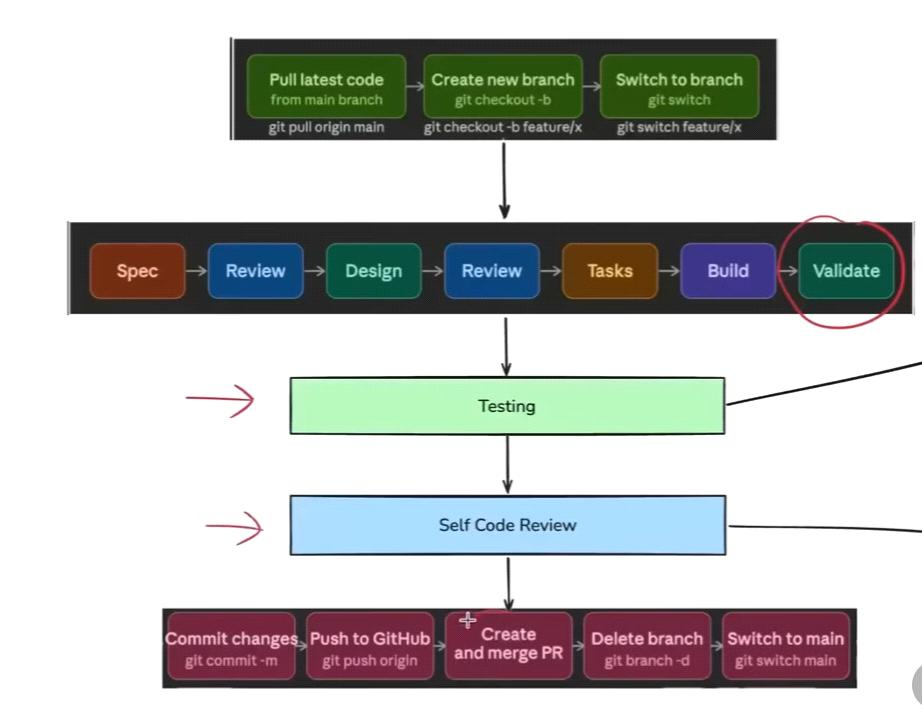
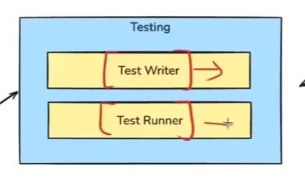
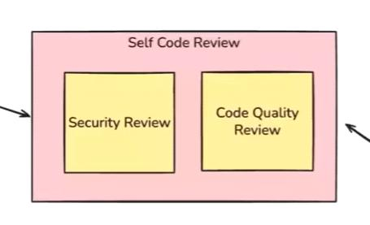

# 10 · Subagents

## Why subagents?
1. **Context keeps growing** (context window explosion).
2. **Lost-in-the-middle effect:** as context grows, LLMs forget what sits in the middle.

The main agent **delegates** a task to a subagent. The subagent has its **own context window**, does the work, and returns only a **summary/plan**, so the main context stays small.

## Advantages
- **Context isolation**
- **Specialization:** each agent has its own tools and prompt (domain expert), e.g. Planner, Coder, Code Reviewer, Git Handler, README Writer working together across the dev cycle
- **Modularity**
- **Parallelism**

## Use cases
- Codebase exploration
- Code review (a *different* agent reviews)
- Verification and validation
- Parallel independent agents

## Types
1. **Built-in:** Claude delegates automatically based on your query (you can trigger them manually too). Examples: **Explore**, **Plan**, **general-purpose** (read + write).
2. **Custom subagents:** your own.

To *see* which subagent is called, try **agents-observe** (`github.com/simple10/agents-observe`, `/observe start`). Idea to explore: trace Claude Code into LangSmith.

## Why custom subagents?
- **Security audit:** the built-in agent can scan for risks but doesn't know *your company's guidelines/checklist*.
- **Testing:** it doesn't know *how you want* the codebase tested.
- → specialization needs a custom agent.

## Creating one

A subagent is a **markdown file with YAML frontmatter**.

| Level | Location |
|---|---|
| Project (shared with team) | `.claude/agents/` |
| Global (personal, all projects) | `~/.claude/agents/` |

You can configure: **tools, prompt, model, permissions, hooks, skills**.

### Frontmatter fields

| Field | Meaning |
|---|---|
| `name` | Unique ID, lowercase with hyphens |
| `description` | Tells Claude **when** to delegate to this agent |
| `tools` | Allowlist of tools (Read, Grep, Glob, Bash...). Inherits all if omitted |
| `disallowedTools` | Denylist; removes tools from the inherited set |
| `model` | `sonnet`, `opus`, `haiku`, full model ID, or `inherit` (default) |
| `permissionMode` | `default`, `acceptEdits`, `auto`, `dontAsk`, `bypassPermissions`, or `plan` |
| `maxTurns` | Max agentic turns before it stops |
| `skills` | Skills to preload into the subagent's context |
| `mcpServers` | MCP servers scoped to this subagent |
| `hooks` | Lifecycle hooks (e.g. `PreToolUse`, `PostToolUse`) |
| `memory` | Persistent memory scope: `user`, `project`, or `local` |
| `background` | `true` to always run in background |
| `effort` | `low`, `medium`, `high`, `xhigh`, or `max` |
| `isolation` | `worktree` = isolated git worktree copy |
| `color` | UI color (red, blue, green, yellow, purple, orange, pink, cyan) |
| `initialPrompt` | Auto-submitted first user turn when run as the main agent |

### Triggering
- **Automatic:** based on your query and the agent's `description`.
- **Manual:** mention it in the prompt, or create a slash command that triggers it.
- `/agents` used to help build subagent files (name, scope, color, tools...). Per the notes it is now **disabled**: just **prompt Claude to create the subagent** for you.
- `/context` shows skills, commands, custom subagents, plugins, MCP, etc.

## Improved feature flow (testing + review before push)

`Pull → branch → Spec → Review → Design → Review → Tasks → Build → Validate → **Testing** → **Self code review** → Commit → Push → PR/merge → delete branch → switch to main`

### `/test-feature` → two subagents

- **Test Writer** writes the tests
- **Test Runner** runs them
- A final summary goes to the main agent.

### `/code-review-feature` → two subagents

- **Security Review**
- **Code Quality Review**
- A final summary goes to the main agent.

---
Prev: [09](09-skills.md) · Next: [11 · MCP](11-mcp.md)
