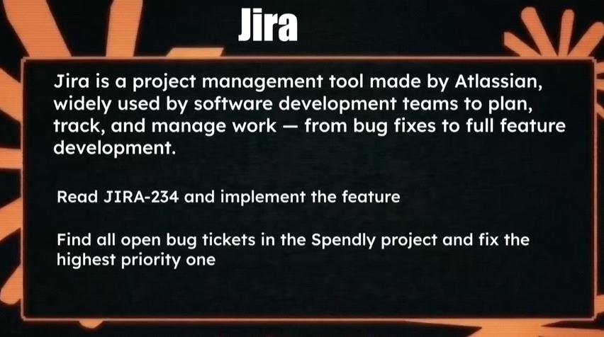
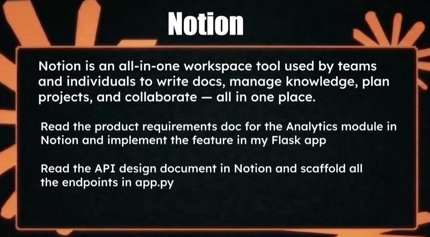
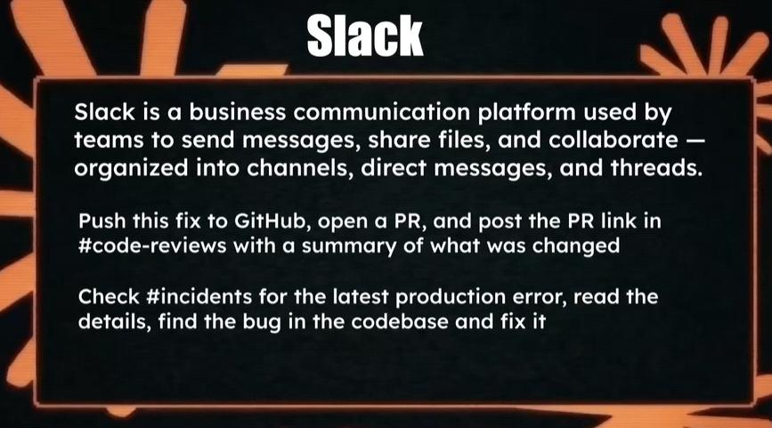
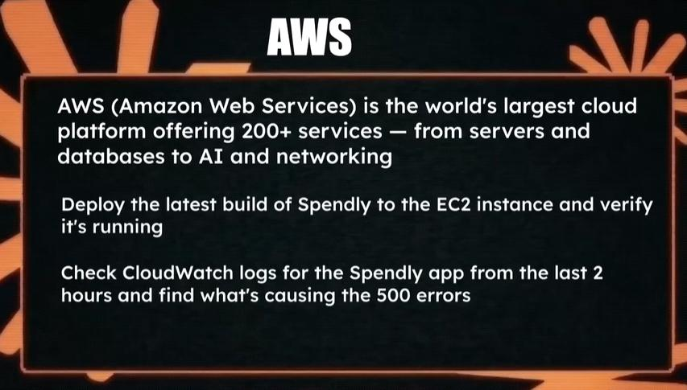
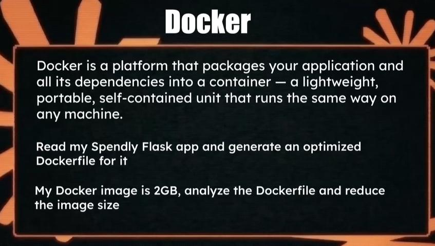

# 11 · MCP (Model Context Protocol)

MCP connects Claude Code to **external tools** for better context engineering: JIRA, Slack, Figma, GitHub, Google Drive, Google Calendar, databases, etc.

- `/mcp` lists all MCP servers (local, built-in, others).
- Remove one: `claude mcp remove <server_name>`
- Project reference: Notion page "Claude Code x MCP" (linked in the original PDF).

## Servers used in the Spendly project

### 1. Database (DBHub → SQLite workaround)
Ask high-level questions about the database **without writing Python code**.
- DBHub doesn't work with a local SQLite DB, so switch to the ExecuteAutomation server:
```bash
claude mcp add --transport stdio sqlite -- npx -y @executeautomation/database-server <path-to>/spendly.db
```
(Provide the path to your own database file.)

### 2. Figma
Design tool (UI/UX) whose designs developers then code.
```bash
claude plugin install figma@claude-plugins-official
```

### 3. GitHub
Lets Claude know about your repos and answer questions on them.
```bash
claude mcp add --transport http github https://api.githubcopilot.com/mcp -H "Authorization: Bearer <YOUR_GITHUB_TOKEN>"
```
> ⚠️ **Never paste a real token into notes or share it.** Create a fine-grained token, store it in an env var, and revoke it if it ever leaks. The original PDF contains a token, so revoke it (see [README](README.md)).

**Automating git with the GitHub MCP**, e.g. prompt:
> Commit all changes with an appropriate conventional commit message, push to the current feature branch, create a pull request into main with a proper title and description based on the spec, merge it using squash merge, switch to main, pull latest, and delete the feature branch locally.

## Typical flow
1. New session per feature
2. `/create-spec`
3. `/plan` for the technical implementation plan
4. Develop and code
5. `/test-feature`, `/code-review` (subagents write tests, check security and quality)
6. GitHub MCP for the git operations

## Other popular MCP servers
| Server | What it's for | Example prompt |
|---|---|---|
| **Context7** | Pulls live, up-to-date docs for any library/framework into context | |
| **Jira** | Project management (Atlassian) | "Read JIRA-234 and implement the feature" / "Find all open bug tickets in Spendly and fix the highest priority one" |
| **Notion** | Shared workspace for docs/knowledge | "Read the product requirements doc for the Analytics module in Notion and implement it in my Flask app" |
| **Slack** | Team messaging | "Push this fix, open a PR, and post the link in #code-reviews with a summary" / "Check #incidents for the latest production error and fix it" |
| **AWS** | Cloud platform (200+ services) | "Deploy the latest Spendly build to EC2 and verify" / "Check CloudWatch logs for the last 2 hours and find the cause of the 500 errors" |
| **Docker** | Containers | "Generate an optimized Dockerfile for my Flask app" / "My image is 2GB, reduce its size" |

### Slides







---
Prev: [10](10-subagents.md) · Next: [12 · Harness & hooks](12-harness-and-hooks.md)
