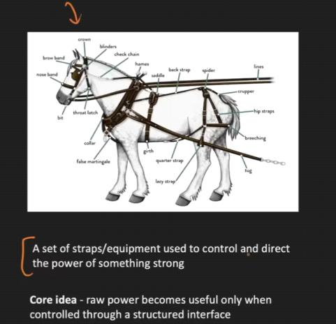
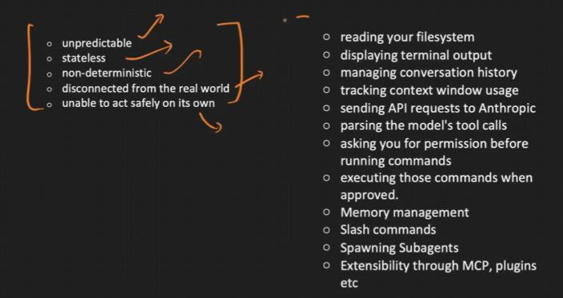
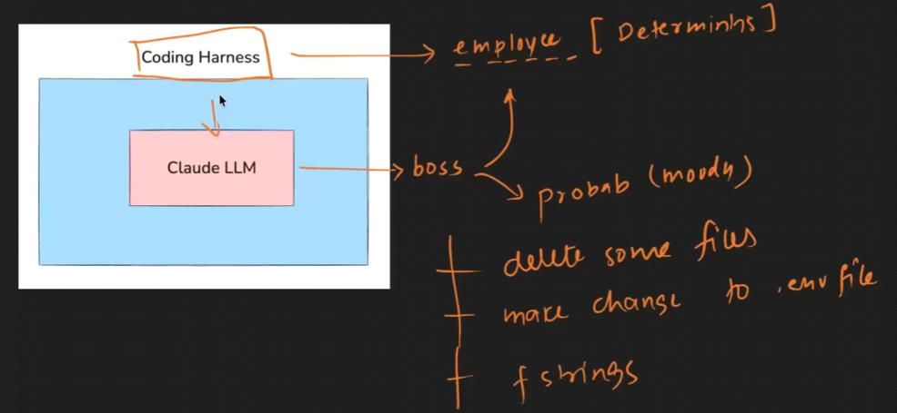
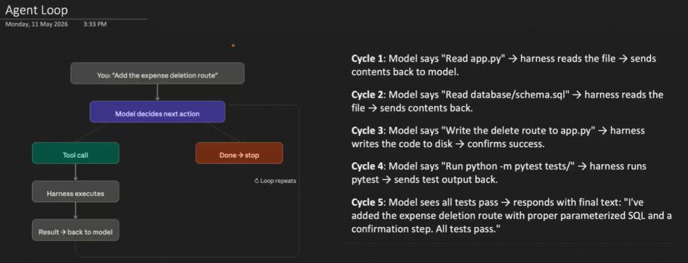
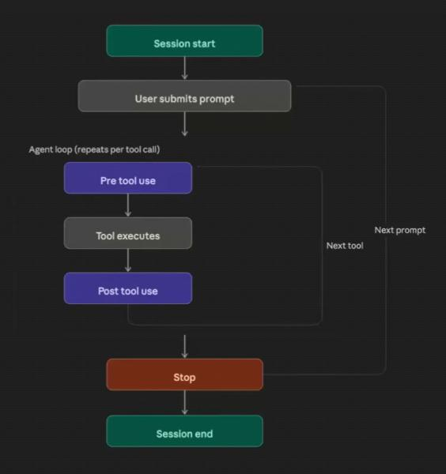
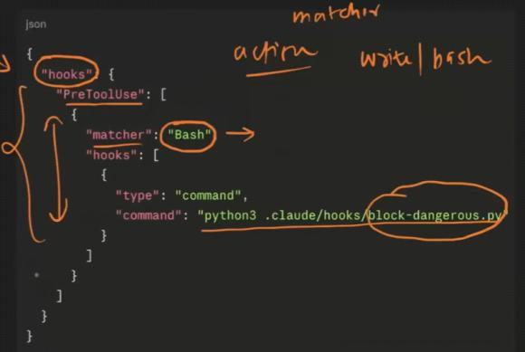

# 12 · Harness Engineering & Hooks

## Claude vs the harness
- **Claude** = an agentic coding agent (the LLM).
- **Harness** = what steers something powerful so it can be controlled.



*Core idea:* raw power becomes useful only when controlled through a structured interface.

### What the LLM can't do alone vs what the harness does


- LLM is: unpredictable, stateless, non-deterministic, disconnected from the real world, unable to act safely on its own.
- The harness handles: reading the filesystem, displaying terminal output, managing conversation history, tracking context usage, sending API requests, parsing tool calls, asking permission before running commands, executing approved commands, memory management, slash commands, spawning subagents, extensibility (MCP, plugins).

Good harnesses: **Claude Code, OpenClaw, Hermes Agent, Pi**. "Harness engineering" is an emerging discipline.

### Employee vs boss


- **Harness = employee (deterministic)**; **Claude LLM = boss (probabilistic, moody)**.
- The boss may decide to delete files, edit your `.env`, etc., and the employee obeys. We need controls for those edge cases. Rare (~2% of the time) but we must be safe in that 2%. → **Hooks**.

## The agent loop


The model picks the next action → either **tool call** (harness executes, result returns to model; loop repeats) or **done → stop**.

Example for "Add the expense deletion route":
1. Model: read `app.py` → harness returns contents
2. Model: read `database/schema.sql`
3. Model: write delete route to `app.py` → harness writes to disk
4. Model: run `python -m pytest tests/` → harness returns output
5. Tests pass → model replies with the final summary

## Session lifecycle & hook events


`Session start → User submits prompt → [Agent loop per tool call: Pre tool use → Tool executes → Post tool use] → Stop → Session end` (loop back for next prompt).

You can attach scripts to these events, e.g. a script on **PreToolUse** that blocks deleting `spendly.db`.

## Hook use cases
1. **Code formatting**: e.g. a Black hook for consistent style
2. **Linting**: pre-checks before code runs
3. **Protecting sensitive files**: e.g. `.env`
4. **Notifications**: attach `notify.sh` to the **Stop** event to get pinged when a long-running agent finishes
5. **Telemetry**: trace every event (agents-observe, LangSmith)
6. **Generating summaries**: at session start, show what's done and what's left

## How to create a hook


Defined in `.claude/settings.json` (and `.claude/settings.local.json` for personal). Scripts live in `.claude/hooks/`.

```json
{
  "hooks": {
    "PreToolUse": [
      {
        "matcher": "Bash",
        "hooks": [
          { "type": "command", "command": "python3 .claude/hooks/block-dangerous.py" }
        ]
      }
    ]
  }
}
```

For each hook define:
- **When** it triggers (event, e.g. `PreToolUse`)
- **Matcher** to narrow it down (e.g. `Bash`, or `Write|Bash`)
- **Action** (the command to run)

Script rules:
- It receives **JSON on stdin** containing tool details and the command.
- Exit code **`2` = block/stop execution**, **`0` = all fine, proceed**.

Hooks are safeguards for your codebase.

## Bonus: `/ship-feature` command
Automates GitHub steps: push the feature branch, auto-write a commit message from the diff, create the PR, merge it, delete the remote branch, checkout `main` and pull, delete the local branch.

Whole pipeline automated: **spec → plan → test → quality check → GitHub (via MCP)**.

---
Prev: [11](11-mcp.md) · Next: [13 · Plugins & marketplaces](13-plugins-and-marketplaces.md)
