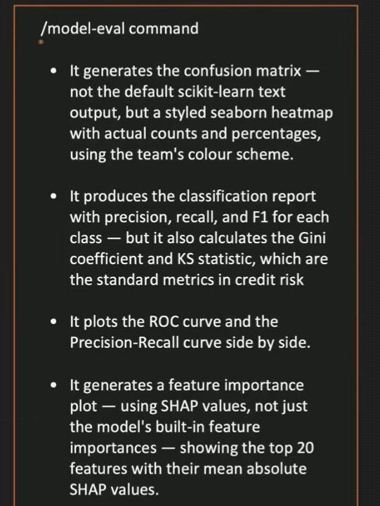
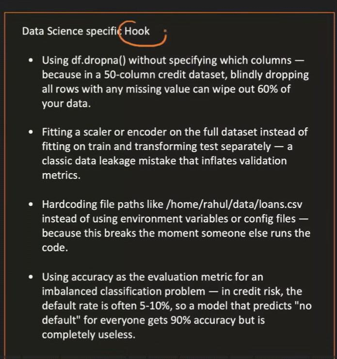
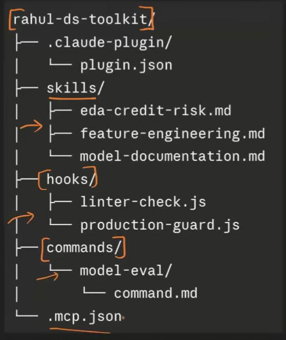
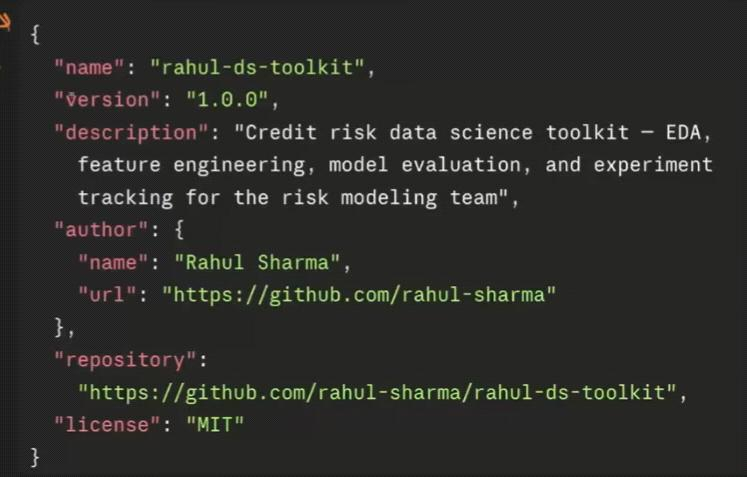
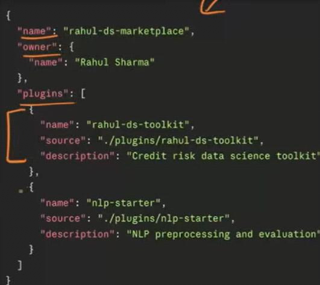

# 13 · Plugins & Marketplaces

## The idea
A data scientist builds, for **credit-risk modelling**:
- **Skills**: e.g. EDA for credit risk, feature engineering, model documentation
- **Commands**: e.g. `/model-eval`
- **Hooks**: safeguards (data-science-specific mistakes)
- **MCP**: e.g. an experiment tracker (pull earlier models, see experiments)

A **plugin packages all of these** (skills, commands, agents, hooks, MCP tools) so an experienced person can hand a ready-made setup to juniors.

### Example `/model-eval` command


Produces a styled seaborn confusion-matrix heatmap with the team's colours, a classification report plus **Gini and KS** (credit-risk standards), ROC and Precision-Recall curves side by side, and a SHAP-based top-20 feature importance plot.

### Example data-science hook


Blocks common mistakes:
- `df.dropna()` without specifying columns (can wipe 60% of a 50-column dataset)
- Fitting a scaler/encoder on the **full** dataset instead of train only (**data leakage**)
- **Hard-coded file paths** instead of env vars/config
- Using **accuracy** on an imbalanced problem (5–10% default rate: predicting "no default" gets ~90% but is useless)

## Plugin structure


```
rahul-ds-toolkit/
├── .claude-plugin/
│   └── plugin.json        (required manifest)
├── skills/
│   ├── eda-credit-risk.md
│   ├── feature-engineering.md
│   └── model-documentation.md
├── hooks/
│   ├── linter-check.js
│   └── production-guard.js
├── commands/
│   └── model-eval/command.md
└── .mcp.json
```

- `.claude-plugin/` folder and `plugin.json` are **mandatory**.

### `plugin.json`


Fields: `name`, `version`, `description`, `author` (`name`, `url`), `repository`, `license`.

## Marketplaces
- A **marketplace** is a repo/area that lists plugins. You can have several.
- Claude Code has a pre-added **official marketplace**; anyone can create their own.
- A marketplace has a `marketplace.json` listing plugins:



Fields: `name`, `owner`, and `plugins[]` (each with `name`, `source` path, `description`).

## `/plugin` command tabs
| Tab | Shows |
|---|---|
| Discover | Plugins available in installed marketplaces |
| Installed | Plugins you have installed |
| Marketplaces | Marketplaces you've added |

Plugins can distribute **agents, hooks, commands and skills**.

## Deployment note (Spendly)
Final feature built: **delete expense**. Deployed using **Railway** (Railway plugin), since Vercel suits Next.js and Spendly is a **Flask** app.

## Great plugins to remember
- **code-simplifier**
- **Context7**
- **skill-creator**
- **Superpowers**
- **frontend-design**

---
Prev: [12](12-harness-and-hooks.md) · Back to [README](README.md)
